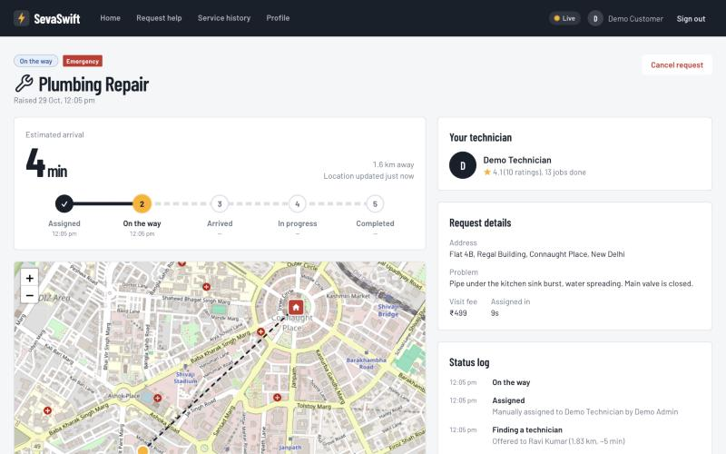
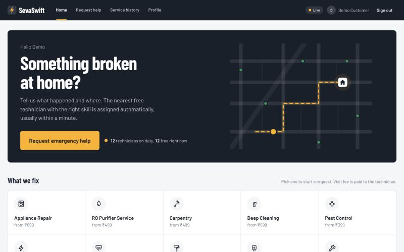
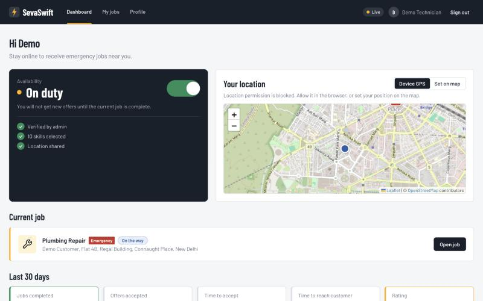
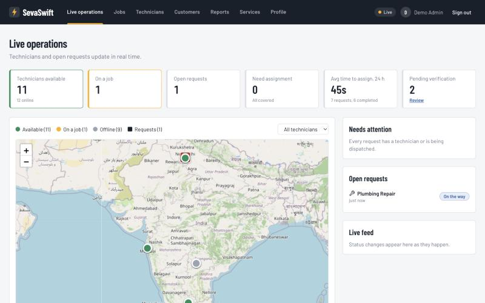
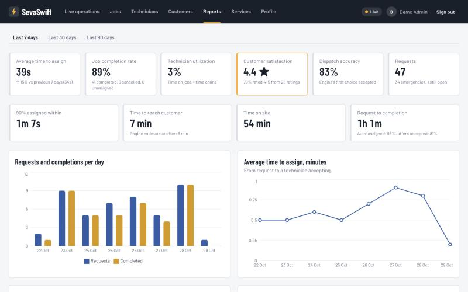
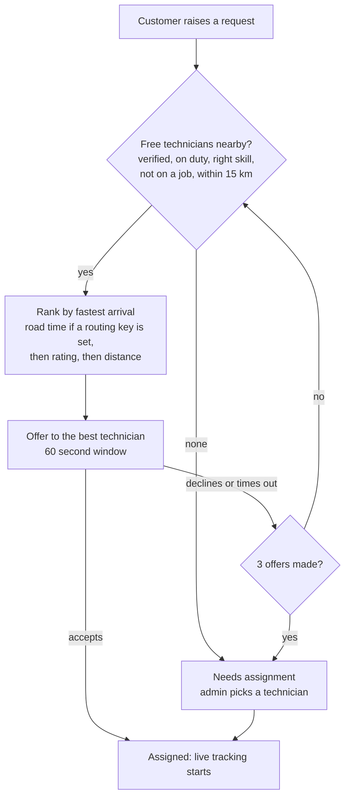
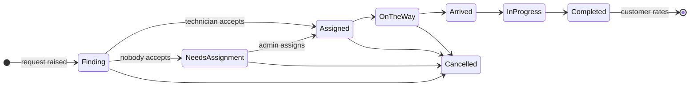
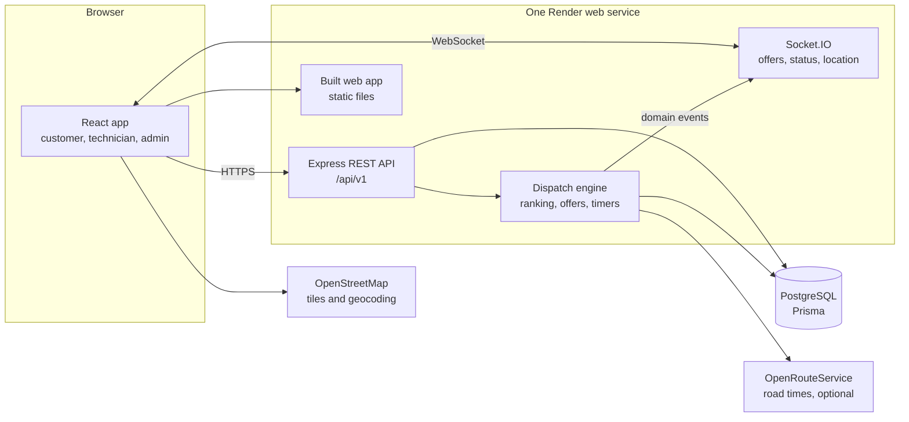

# SevaSwift

**Emergency home services with automatic dispatch.** A customer reports a burst pipe or a dead AC,
and the nearest free, verified technician with the right skill gets the job within seconds. The
customer then follows them to the door on a live map.

**Live app: [sevaswift.onrender.com](https://sevaswift.onrender.com)** ·
[](https://github.com/xreep/sevaswift/actions/workflows/ci.yml)



> The free hosting plan sleeps when idle. The first visit after a quiet spell can take up to a
> minute to wake the server; after that it is fast.

## Try it

Every demo account uses the password **`Demo@123`**. The login page also has one-click "Fill"
buttons for each account.

| Role | Email | What to look at |
|---|---|---|
| Customer | `customer@demo.sevaswift` | Raise a request, then watch it get assigned and tracked |
| Technician | `tech@demo.sevaswift` | Go on duty, accept the pop-up offer, drive to the customer |
| Admin | `admin@demo.sevaswift` | Live operations map, manual assignment, verification, reports |

**The full emergency in five minutes.** Open the app in two windows (one normal, one private):

1. Sign in as the **technician**. You are on duty in central Delhi. Under *Your location*, choose
   **Set on map** and tap near Connaught Place, since browsers often block GPS.
2. Sign in as the **customer**, choose **Request emergency help**, pick a service and search
   "Connaught Place". Before you send, the form shows how many technicians are free nearby.
3. The technician gets a pop-up offer with a 60-second countdown and a sound. Accept it.
4. Tap **Start driving to customer**, then **Simulate drive to customer**. The customer's map and
   ETA update every two seconds. Then mark *Arrived*, *In progress* and *Completed*, and leave a
   rating as the customer.
5. Ignore or decline an offer instead to watch it move to the next-nearest technician. After three
   unanswered offers it lands in the admin's **Needs assignment** queue.

The demo data includes 21 technicians across Delhi, Mumbai, Bangalore and Hyderabad, two applicants
waiting for verification, and 30 days of realistic history, so every report has numbers.

## What each role gets

| | |
|---|---|
|  |  |
| **Customers** raise a request with service, emergency or standard priority, location (GPS, address search or a pin on the map), a description and up to three photos. They see coverage before sending, track the technician live, cancel before arrival, and rate the job afterwards. | **Technicians** go on or off duty, share their location (device GPS or set on the map), get offers with a countdown and sound, move the job through each status, and see their own 30-day performance and skills. |
|  |  |
| **Admins** watch every technician and open request on a live map and feed. They assign jobs nobody accepted, verify or reject new technicians, suspend accounts and manage the service catalogue. | **Reports** cover response time against the previous period, completion rate, utilization, customer satisfaction and dispatch accuracy. Charts break these down by day, hour and service, and jobs export as CSV. |

## How auto-dispatch works



- Offers are created under a database lock, so no technician ever holds two offers at once.
- Accepting is an atomic compare-and-set: if two accepts race, exactly one wins.
- Offer timers are restored from the database after a restart, so a redeploy never strands a job.
- Every offer is logged with its distance, ETA, outcome and response time, and every status change
  is logged with a timestamp. Those logs feed the reports.

### Job lifecycle



## Architecture



The API, the live updates and the web app share one origin, so login cookies are first-party and
there is no cross-site setup to get wrong. Domain events (offer made, status changed, location
updated) go through an in-process event bus that the Socket.IO layer subscribes to.

| Layer | Choice |
|---|---|
| Frontend | React 18, TypeScript, Vite, Tailwind CSS, React Router, Leaflet, Recharts |
| Backend | Node.js 20, Express 5, TypeScript, Socket.IO, zod validation |
| Data | PostgreSQL 16 with Prisma migrations |
| Maps | OpenStreetMap tiles and Nominatim search (no API key); OpenRouteService for road times when keyed |
| Hosting | Render Blueprint (`render.yaml`): one web service and one database; Dockerfile for other hosts |
| CI | GitHub Actions: typecheck, lint and tests for the backend; tests and build for the frontend |

## PRD coverage

| Requirement | How it is met |
|---|---|
| Secure login, three roles, access control | JWT access tokens plus rotating httpOnly refresh cookies, with token-reuse detection; every route checks the role; pages are role-guarded |
| Profile management | Edit name and phone; changing the password signs out other devices |
| Emergency request | Service, priority, GPS or address search or map pin, description, photo upload with real image checks |
| Auto-dispatch engine | Radius, skill and availability filter; fastest-arrival ranking; automatic offer; re-dispatch on decline or timeout |
| Real-time tracking | Live location and ETA over Socket.IO; Assigned, On the way, Arrived, In progress, Completed |
| Admin dashboard | Live map and feed, open and unassigned jobs, technician availability, response times, analytics and CSV reports |
| Service history | Customer and technician history, full status log and dispatch log per job |
| Feedback | 1 to 5 star rating with comment, feeding technician ratings and customer satisfaction |
| KPIs | Response time and its change, utilization, completion rate, satisfaction, dispatch accuracy |
| System logs | Offer log, status history and technician on/off duty log in the database |
| Validation, errors, security | zod on every input, consistent error format, Helmet CSP, rate limiting, bcrypt, formula-safe CSV export, private database network |

### How the KPIs are measured

| KPI | Definition |
|---|---|
| Time to assign | Request raised until a technician accepts, compared with the previous period |
| Job completion rate | Completed ÷ closed requests (completed, cancelled or never assigned) |
| Technician utilization | Time spent on jobs ÷ time on duty, from the on/off duty log |
| Customer satisfaction | Average rating and the share of 4 and 5 star ratings |
| Dispatch accuracy | Share of auto-dispatched jobs taken by the engine's first choice |

## Run it locally

You need Node.js 20, npm and Docker (for Postgres).

```bash
docker compose up -d
```

```bash
cd backend && cp .env.example .env && npm install && npx prisma migrate dev && npm run prisma:seed && npm run dev
```

```bash
cd frontend && npm install && npm run dev
```

The web app runs on http://localhost:5173 and proxies `/api` and `/socket.io` to the API on port 4000.

### Tests

```bash
cd backend && npm test
```

```bash
cd frontend && npm test
```

The backend has 89 integration tests against a dedicated `sevaswift_test` database. They cover
auth and security, dispatch ranking and races, the job lifecycle, real-time events, admin
operations, analytics figures, uploads and availability. The frontend has 24 tests covering role
routing, the request form, job progress and helpers.

## Deploy

**Render:** in the Render dashboard choose **New → Blueprint** and pick this repository.
`render.yaml` creates the database and the web service in the same region, generates the JWT
secrets, runs migrations and loads the demo data on every start (the loader is idempotent). Pushing
to `main` redeploys automatically.

**Anywhere else:** `docker build -t sevaswift .` and run it with the variables below.

| Variable | Purpose |
|---|---|
| `DATABASE_URL` | PostgreSQL connection string |
| `JWT_ACCESS_SECRET`, `JWT_REFRESH_SECRET` | Token signing secrets, 32+ characters each |
| `CORS_ORIGIN`, `APP_URL` | Public URL of the app (defaults to Render's URL) |
| `FRONTEND_DIST` | Path to the built web app for the API to serve, e.g. `../frontend/dist` |
| `DISPATCH_RADIUS_KM`, `OFFER_TIMEOUT_SECONDS`, `MAX_DISPATCH_ROUNDS`, `AVERAGE_SPEED_KMPH` | Dispatch tuning; defaults 15, 60, 3, 25 |
| `ORS_API_KEY` | Optional OpenRouteService key for road travel times |
| `SMTP_URL`, `MAIL_FROM` | Optional SMTP for verification and reset emails; without it the links go to the server log |
| `REPORT_TIMEZONE` | Time zone for daily and hourly analytics; default `Asia/Kolkata` |

## Project structure

```
backend/
  prisma/              schema, migrations, demo data loader
  src/
    common/            errors, events bus, geo maths, mail, auth and validation middleware
    modules/
      auth/            register, login, refresh, verify email, reset password
      users/           profile and password change
      technicians/     availability, skills, location, offers, performance
      catalog/         services
      jobs/            requests, lifecycle, reviews
      dispatch/        ranking, offers, timers, availability counts
      realtime/        Socket.IO gateway
      uploads/         issue photos
      admin/           live ops, workforce, manual assignment, analytics, CSV
frontend/
  src/
    pages/             customer, technician, admin, shared job and profile pages
    components/        layout, maps, job progress, offer alert, icons, UI kit
    contexts/          auth, socket, technician session, toasts
    services/api.ts    typed API client
render.yaml            Render Blueprint
Dockerfile             single-image build
```

<details>
<summary><strong>API reference</strong></summary>

All REST endpoints are under `/api/v1`. Errors look like `{ status, code, message, fieldErrors? }`.

- **Auth:** `POST /auth/register`, `/auth/login`, `/auth/refresh`, `/auth/logout`, `/auth/verify-email`, `/auth/forgot-password`, `/auth/reset-password`; `GET /auth/me`
- **Profile:** `GET` and `PATCH /users/me`; `POST /users/me/password`
- **Uploads:** `POST /uploads` (multipart `file`, JPEG, PNG or WebP up to 5 MB); `GET /uploads/:id`
- **Services:** `GET /services`, `GET /services/:id`; admin `POST /services`, `PATCH` and `DELETE /services/:id`
- **Jobs:** `POST /jobs`; `GET /jobs?status=&active=`; `GET /jobs/:id`; `POST /jobs/:id/accept`, `/reject`, `/status`, `/cancel`, `/review`
- **Availability:** `GET /availability?lat=&lng=&serviceId=`
- **Technician:** `GET /technicians/me`; `PATCH /technicians/me/availability`; `PUT /technicians/me/skills`; `POST /technicians/me/location`; `GET /technicians/me/offers`, `/technicians/me/stats`
- **Admin:** `GET /admin/overview`, `/admin/live`, `/admin/services`, `/admin/technicians`, `/admin/users`, `/admin/jobs/:id/candidates`, `/admin/analytics?days=`, `/admin/reports/jobs.csv?days=`; `PATCH /admin/technicians/:id/verification`, `/admin/users/:id/status`; `POST /admin/jobs/:id/assign`

**Real-time:** connect with `io({ auth: { token: accessToken } })`.

| Event from server | Sent to | Payload |
|---|---|---|
| `offer:new`, `offer:closed` | The offered technician | `{ jobId, offerId, expiresAt }`, `{ jobId, offerId, reason }` |
| `job:status` | Customer, assigned technician, admins, job subscribers | `{ jobId, from, to, at }` |
| `job:location` | Job subscribers | `{ jobId, lat, lng, at, eta }` |
| `technician:location`, `technician:availability` | Admins | `{ technicianId, lat, lng, at }`, `{ technicianId, isOnline }` |

Clients send `job:subscribe { jobId }` (acknowledged; only people allowed to see the job) and `job:unsubscribe`.

</details>

## Known limitations

- **Free hosting:** the server sleeps after about 15 idle minutes, and the free database expires
  on 28 November 2026 unless it is upgraded.
- **ETA without a routing key:** it is a straight-line distance at an average city speed. Set
  `ORS_API_KEY` for road travel times.
- **Email:** without `SMTP_URL`, verification and password-reset links are written to the server
  log instead of being emailed.
- **Out of scope for phase 1, as per the PRD:** payments, demand prediction and native mobile apps.
  The web app works on phones.

## Design notes

The design spec and implementation plans live in [`docs/superpowers`](docs/superpowers).
